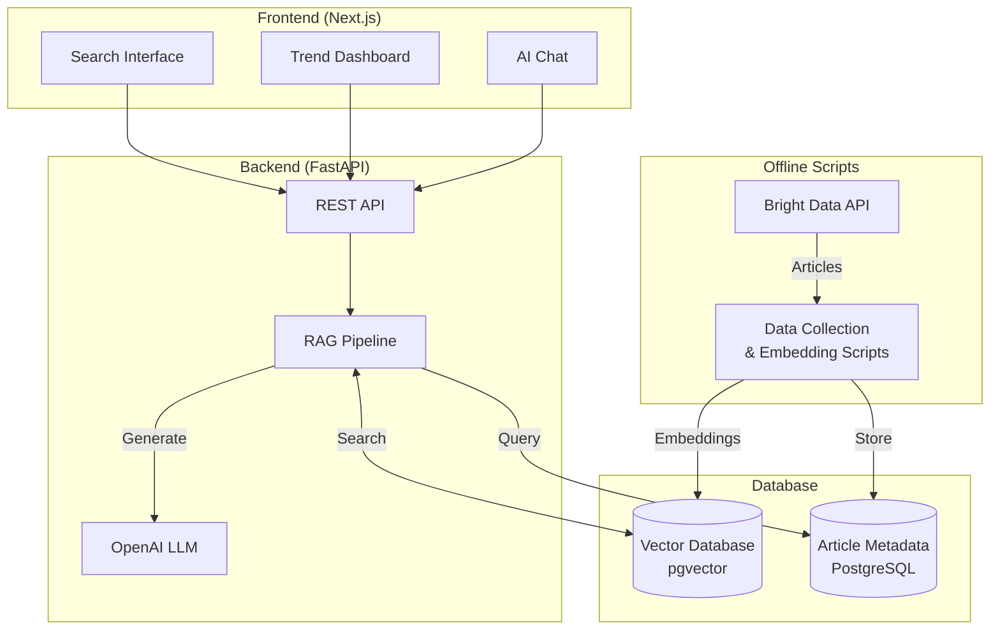
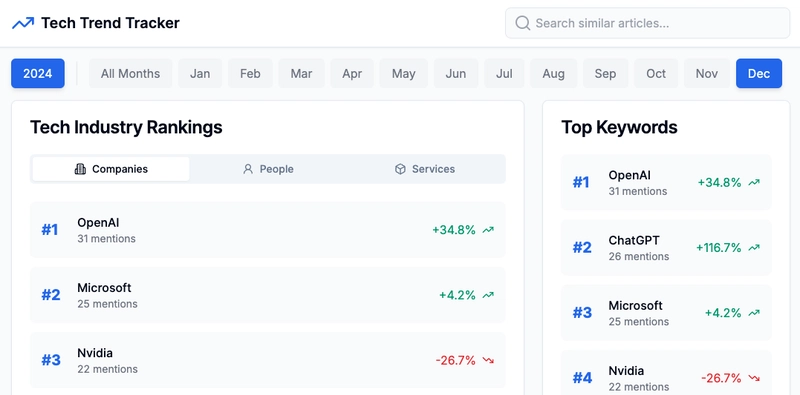
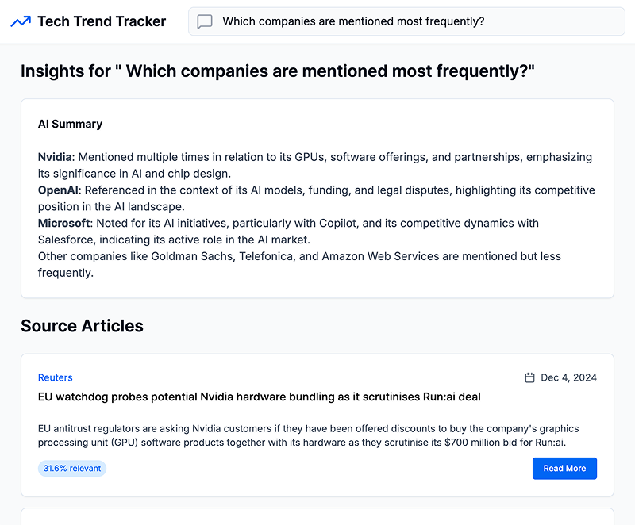

# Tech Trend Tracker

A full-stack application that tracks technology trends from news articles.

## Overview

Tech Trend Tracker collects articles from Reuters, processes them with OpenAI embeddings, and displays monthly technology trends and keyword rankings. This app also includes RAG-enhanced semantic search and AI-powered article summaries. The demo uses data from 2024/01 to 2024/12.

## Features

- RAG-enhanced search:
  - Text chunking & embeddings
  - AI-powered summaries
  - Referenced sources with scores
- Keyword-based article search
- Trending entity analysis (companies, people, services)
- Keyword frequency tracking

## Tech Stack

- Frontend: Next.js, Tailwind CSS, shadcn/ui
- Backend: Python, FastAPI
- Database: PostgreSQL with pgvector
- AI models: OpenAI (embeddings, text generation)

## Architecture



## Screenshot




## Local Setup

1. Clone the repository:

```bash
git clone git@github.com:yukaty/tech-trend-tracker.git
cd tech-trend-tracker
```

2. Configure environment variables:

```bash
cp .env.example .env
```

3. Start backend services:

```bash
docker compose up --build
```

4. Run frontend development server:

```bash
cd frontend
npm install
npm run dev
```

- http://localhost:3000 for the web interface
- http://localhost:8000/docs for the API documentation

## Future Plans

- Additional data sources (RSS feeds, APIs)
- Enhanced search accuracy
- Advanced visualizations
- Performance optimization

## License

MIT License

_Feel free to open issues and pull requests. All feedback and contributions are welcome!_
